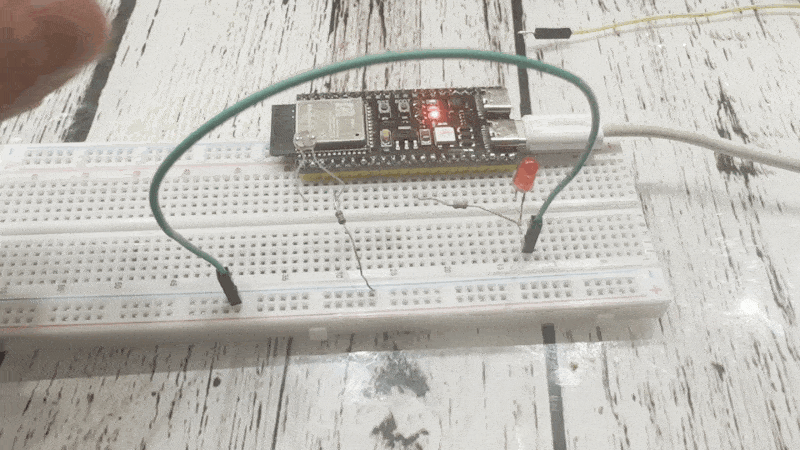

# ESP32 Light PID Controller

A feedback controller that adjusts LED brightness to maintain a target light
sensor reading. Written in C using **ESP-IDF and PlatformIO** on an ESP32-S3.

- 50 Hz control loop with 5 kHz, 12-bit LEDC PWM.
- Averaged and smoothed ADC readings from an LDR voltage divider.
- PID with integral anti-windup and derivative on measurement.
- BOOT button cycles through three setpoints; serial CSV output records the response.

## Hardware

**ESP32-S3-DevKitC-1-N16R8 / N16R8V**, an external LED, an LDR and resistors.

| Connection | Wiring |
|---|---|
| LED | GPIO8 → 330 Ω → LED anode; cathode → GND |
| LDR | 3V3 → LDR → GPIO4 |
| Divider resistor | GPIO4 → resistor → GND; select 1–10 kΩ to suit the light level |
| Optional ADC filter | 100 nF between GPIO4 and GND |
| BOOT | Onboard button, GPIO0 |

Fix the LED facing the LDR so its light reaches the sensor. Choose the divider
resistor and ambient lighting to keep the ADC from saturating.

## Build and Run

```sh
pio run -e esp32-s3
pio run -e esp32-s3 -t upload
pio device monitor -e esp32-s3
```

Use the board's **USB-to-UART** port at **115200 baud**. The project pins
Espressif32 7.0.1 / ESP-IDF 6.0.1 and configures 16 MB flash; PSRAM is unused.

## Operation

Control starts immediately at **30%**. Each BOOT release advances the target:
**30% → 50% → 70% → 30%**.

Readings use a fixed scale: **0–4095 ADC counts → 0–100%**. Setpoints refer to
the ADC range, not lux or PWM duty. A target must be reachable by varying the LED
brightness under the current ambient light.

Tune `PID_KP`, `PID_KI` and `PID_KD` in [src/pid.h](src/pid.h).
[src/main.c](src/main.c) handles peripherals and the control loop;
[src/pid.c](src/pid.c) implements the regulator.

Serial output is emitted at approximately 10 Hz:

```text
time_ms,setpoint_pct,light_pct,pwm_pct
```

## Demo



